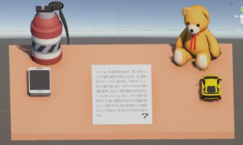
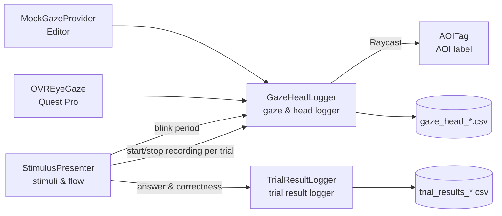

# VR-Attention-Logger

[日本語](README.md) | English

A Unity-based experiment system that uses the eye tracking of Meta Quest Pro to record, as a time series, the **gaze direction, head direction, and the AOI (area of interest) being looked at** in VR.

During a reading task, objects around the participant (a phone, a plush toy, and a toy car) blink to induce attention deviation, and the system records the "gap between gaze and head direction" at that moment. It was developed during an internship at the Nara Institute of Science and Technology (NAIST) and is used for data collection in my undergraduate thesis at the University of the Ryukyus, *"Learning-based construction of an attention-deviation classifier based on the divergence between gaze and head direction"*.



*Experiment scene. The reading panel in the center is the task area. All four surrounding objects are registered as distractor AOIs; three of them (phone, plush toy, car) blink, while the grenade does not.*

## Features

- **Gaze / head-direction logger**: records the gaze vector, the head vector, and the angle $\theta$ between them to CSV (50 Hz by default)
- **AOI detection**: raycasts along the gaze ray and classifies the hit object as the task area or a distractor
- **Stimulus presentation**: shows a reading passage followed by a four-choice question, and logs the answer and correctness per trial
- **Attention-deviation induction**: on selected trials, randomly blinks one distractor's light and logs the blinking period
- **Mock gaze mode**: lets you test in the Unity Editor without a headset, using the mouse position as the gaze

## Angle between gaze and head direction

With gaze direction $\mathbf{g}$ and head direction $\mathbf{h}$, the following angle is recorded for every sample:

$$
\theta = \arccos\left(\frac{\mathbf{g}\cdot\mathbf{h}}{\|\mathbf{g}\|\,\|\mathbf{h}\|}\right)
$$

$\theta$ grows when the eyes look sideways while the head keeps facing forward. This value is used as a feature for detecting attention deviation.

## Architecture



| Script | Role |
| --- | --- |
| `GazeHeadLogger.cs` | Logs gaze, head direction, and AOI to CSV at a fixed interval |
| `StimulusPresenter.cs` | Presents passages and questions in order, and controls recording and distractor blinking |
| `TrialResultLogger.cs` | Logs the answer, correct answer, correctness, and duration, one row per trial |
| `AOITag.cs` | Attaches an AOI name and type (task / distractor) to an object |
| `ExperimentController.cs` | Toggles recording and AOI visibility from the keyboard (for setup) |
| `MockGazeProvider.cs` | Simulates gaze with the mouse (for Editor testing) |

## Output data

### `gaze_head_<participant>_<trial>_<datetime>.csv` (gaze time series)

| Column | Description |
| --- | --- |
| `participant_id`, `trial_id` | Participant ID and trial ID |
| `timestamp` | Recording time (ISO 8601) |
| `gaze_origin_x/y/z` | Origin of the gaze ray |
| `gaze_dir_x/y/z` | Gaze direction (unit vector) |
| `head_dir_x/y/z` | Head direction (unit vector) |
| `angle_deg` | Angle $\theta$ between gaze and head direction [deg] |
| `hit_aoi` | Name of the AOI hit by the gaze (`None` if none) |
| `is_task_area`, `is_distractor_area` | Whether the task area / a distractor is being looked at (0/1) |
| `gaze_confidence`, `tracking_valid` | Gaze confidence and tracking-valid flag |
| `distractor_active`, `distractor_lit` | Whether a distractor is blinking (0/1) and which one |

Samples where tracking was lost are kept with `tracking_valid=0`, so they can be treated as missing values during analysis.

### `trial_results_<participant>_<datetime>.csv` (trial results)

`participant_id`, `trial_id`, `passage_index`, `selected`, `correct`, `is_correct`, `timestamp_start`, `timestamp_end`, `duration_sec`

Join with the gaze log on `participant_id` + `trial_id`.

## Requirements

- Unity 6000.4.5f1 (URP)
- Meta Quest Pro (eye tracking required)
- Meta XR SDK (`OVREyeGaze`, `OVRInput`)
- Build target: Android

## Usage

### Try it in the Editor (no headset)

1. Open `Assets/Scenes/SampleScene_VR.unity`
2. Turn **Use Mock Gaze** ON in `GazeHeadLogger`
3. Press Play; the mouse position is treated as the gaze

### Record on the device

1. Turn **Use Mock Gaze** OFF in `GazeHeadLogger`
2. Enable eye tracking on the Quest Pro and run the calibration
3. Build for Android and install it on the Quest Pro
4. Pass the participant ID through an adb launch option

   ```bash
   adb shell am start -n <package>/<activity> --es participant_id P002
   ```

5. CSV files are saved to `Application.persistentDataPath` on the device

### Controls

| Action | Keyboard (experimenter) | Quest controller (participant) |
| --- | --- | --- |
| Passage → question | Space | A / B / trigger |
| Move selection | ↑ / ↓ | Thumbstick up / down |
| Confirm answer | Enter | Trigger |

## Future improvements

- Sampling runs in `Update()`, so the logging interval depends on the frame rate
- Timestamps use the system clock (`DateTimeOffset.Now`); switching to a monotonic clock is under consideration
