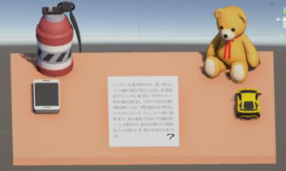
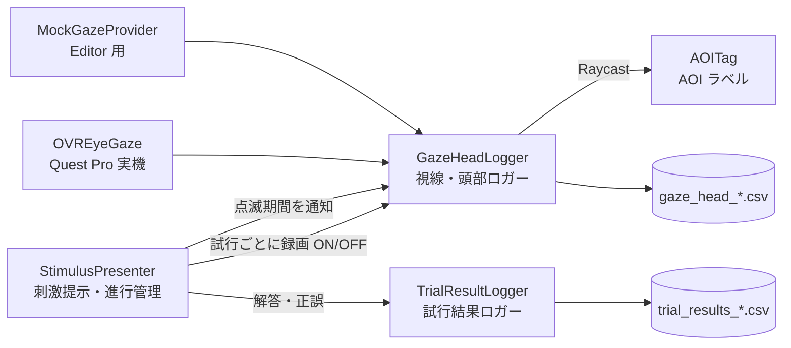

# VR-Attention-Logger

Meta Quest Pro のアイトラッキングを使って、VR 空間での **視線方向・頭部方向・注視している AOI（注目領域）** を時系列で記録する Unity 製の実験システムです。

読解タスク中に周囲の物体（スマホ・ぬいぐるみ・車）を点滅させて注意逸脱を誘発し、そのときの「視線と頭部方向のズレ」を記録します。視線と頭部方向の乖離から注意逸脱を判定する研究のデータ収集用に開発しました。



*実験シーン。中央の読解パネルがタスク領域で、周囲の物体が注意逸脱を誘う distractor。*

## 主な機能

- **視線・頭部方向ロガー**：視線ベクトルと頭部ベクトル、両者のなす角 $\theta$ を CSV に記録（既定 50 Hz）
- **AOI 判定**：視線レイを Raycast し、当たったオブジェクトがタスク領域か注意逸脱候補（distractor）かを判定
- **刺激提示**：読解パッセージ → 4 択問題の順に提示し、解答と正誤を試行ごとに記録
- **注意逸脱の誘発**：指定した試行で、distractor のライトをランダムに 1 つ点滅させ、その期間をログに記録
- **Mock 視線モード**：実機がなくても、Unity Editor 上でマウス位置を視線として動作確認できる

## 視線と頭部方向のなす角

視線方向ベクトルを $\mathbf{g}$、頭部方向ベクトルを $\mathbf{h}$ として、毎サンプル次の角度を記録します。

$$
\theta = \arccos\left(\frac{\mathbf{g}\cdot\mathbf{h}}{\|\mathbf{g}\|\,\|\mathbf{h}\|}\right)
$$

頭は前を向いたまま目だけ横を見ると $\theta$ が大きくなります。この値を注意逸脱判定の特徴量として使います。

## システム構成



| スクリプト | 役割 |
| --- | --- |
| `GazeHeadLogger.cs` | 視線・頭部方向・AOI を一定間隔で CSV に記録する |
| `StimulusPresenter.cs` | パッセージと問題を順に提示し、録画の開始・停止と distractor の点滅を管理する |
| `TrialResultLogger.cs` | 1 試行 1 行で解答・正解・正誤・所要時間を記録する |
| `AOITag.cs` | オブジェクトに AOI 名と種別（タスク / distractor）を付ける |
| `ExperimentController.cs` | キーボードで録画や AOI 表示を切り替える（調整用） |
| `MockGazeProvider.cs` | マウス操作で視線を模擬する（Editor テスト用） |

## 出力データ

### `gaze_head_<参加者ID>_<試行ID>_<日時>.csv`（視線の時系列）

| 列 | 内容 |
| --- | --- |
| `participant_id`, `trial_id` | 参加者 ID・試行 ID |
| `timestamp` | 記録時刻（ISO 8601） |
| `gaze_origin_x/y/z` | 視線レイの原点 |
| `gaze_dir_x/y/z` | 視線方向（単位ベクトル） |
| `head_dir_x/y/z` | 頭部方向（単位ベクトル） |
| `angle_deg` | 視線と頭部方向のなす角 $\theta$ [deg] |
| `hit_aoi` | 視線が当たった AOI 名（なければ `None`） |
| `is_task_area`, `is_distractor_area` | タスク領域 / distractor を見ているか（0/1） |
| `gaze_confidence`, `tracking_valid` | 視線の信頼度・トラッキング有効フラグ |
| `distractor_active`, `distractor_lit` | 点滅中か（0/1）・点滅している物体名 |

トラッキングが取れなかったサンプルも `tracking_valid=0` として残し、解析時に欠損として扱えるようにしています。

### `trial_results_<参加者ID>_<日時>.csv`（試行結果）

`participant_id`, `trial_id`, `passage_index`, `selected`, `correct`, `is_correct`, `timestamp_start`, `timestamp_end`, `duration_sec`

視線ログとは `participant_id` + `trial_id` で突き合わせます。

## 動作環境

- Unity 6000.4.5f1（URP）
- Meta Quest Pro（アイトラッキング必須）
- Meta XR SDK（`OVREyeGaze`, `OVRInput`）
- ビルドターゲット：Android

## 使い方

### Editor で試す（実機なし）

1. `Assets/Scenes/SampleScene_VR.unity` を開く
2. `GazeHeadLogger` の **Use Mock Gaze** を ON にする
3. Play して、マウスを動かすと視線として扱われる

### 実機で記録する

1. `GazeHeadLogger` の **Use Mock Gaze** を OFF にする
2. Quest Pro でアイトラッキングを有効にし、キャリブレーションを行う
3. Android 向けにビルドして Quest Pro にインストールする
4. 参加者 ID は adb の起動オプションで渡せる

   ```bash
   adb shell am start -n <package>/<activity> --es participant_id P002
   ```

5. CSV は端末の `Application.persistentDataPath` に保存される

### 操作

| 場面 | キーボード（実験者） | Quest コントローラー（参加者） |
| --- | --- | --- |
| パッセージ → 問題へ進む | Space | A / B / トリガー |
| 選択肢を移動 | ↑ / ↓ | スティック上下 |
| 解答を確定 | Enter | トリガー |

## 今後の改善点

- サンプリングを `Update()` で行っているため、記録間隔がフレームレートの影響を受ける
- タイムスタンプがシステム時刻（`DateTimeOffset.Now`）のため、単調増加する時計への置き換えを検討している
